<div align="center">

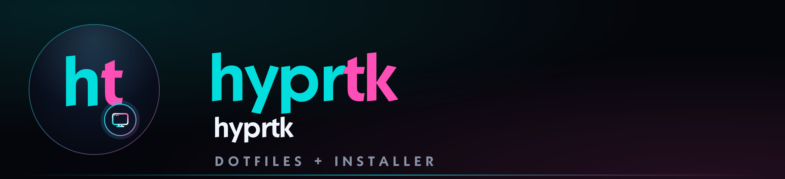

[](CHANGELOG)
[](README.md#portability)
[](LICENSE)
[](#branding)

# hyprtk dots

A single installer for a fully themed **Hyprland (Wayland)** desktop on **any Linux distribution** — with **XFCE (Xorg)** kept as a safety net.

**Any distro. One install. One pywal-powered theme.**

`Arch` · `Archbang` · `Archcraft` · `Archman` · `BSLX` · `CachyOS` · `EndeavourOS` · `Garuda` · `Kiro` · `Manjaro` · `RebornOS` · `Debian/Ubuntu` · `Fedora/RHEL` · `openSUSE` · `Void` · `Alpine` · `Gentoo` · `NixOS`

---

[Install](#install) · [Features](#features) · [Portability](#portability) · [Keybindings](#keybindings) · [Applications](#applications) · [Gallery](#gallery)

</div>

---

> **The hyprtk suite** — this repository is the desktop itself.
> Apps: [dotfiles](https://github.com/hyprtk/dotfiles) · [system settings](https://github.com/hyprtk/hyprtk-system-manager) · [bar-qt](https://github.com/hyprtk/hyprtk-bar-qt) · [file manager](https://github.com/hyprtk/hyprtk-file-manager) · [editor](https://github.com/hyprtk/hyprtk-editor) · [terminal](https://github.com/hyprtk/hyprtk-term) · [calculator](https://github.com/hyprtk/hyprtk-calc) · [screenshot](https://github.com/hyprtk/hyprtk-shot) · [recorder](https://github.com/hyprtk/hyprtk-rec) · [config manager](https://github.com/hyprtk/hyprtk-hyprland-config-manager) · [hyprtk-usb](https://github.com/hyprtk/hyprtk-usb) · [ISO creator](https://github.com/hyprtk/Hyprtk-ISO-Creator)

## What is this?

A curated, consistent desktop configuration that replaces the default look and feel of your Linux desktop with a polished Hyprland setup. One wallpaper drives every colour on screen via **pywal16** (bundled) — hyprtk-bar-qt, the app launcher, the lock screen and even your icons all stay in sync.

- **Wayland first** — Hyprland with a floating/split hybrid workflow
- **Xorg fallback** — XFCE stays installed as a safety net
- **Native file manager** — **hyprtk-fm**, a Qt6/QML file manager (tabs, dual pane, thumbnails, LAN share browsing), pywal-themed; Thunar stays installed as a fallback
- **Auto-detected distro** — the installer detects your OS and package manager (pacman/apt/dnf/zypper/xbps/apk) and applies the right tweaks
- **No manual colour config** — pywal generates a full palette from your wallpaper
- **No AUR dependency for pywal** — pywal16 is bundled inside hyprtk-bar-qt (`vendor/pywal16`), so colours work out of the box

## Install

> Back up your existing `~/.config` before running.

```bash
git clone https://github.com/hyprtk/dotfiles.git ~/hyprtk
cd ~/hyprtk
sh ./1-install.sh
```

The installer is a guided `gum` TUI: it detects your distro, then asks about
package groups, dotfiles and services before installing everything.

> Every system is different — results can vary. Review the prompts before accepting.

## Portability

The installer works across distribution families via a single package-manager
abstraction (`installer/scripts/pkgmanager.sh`): **Arch** (pacman + AUR),
**Debian/Ubuntu** (apt), **Fedora/RHEL** (dnf), **openSUSE** (zypper), **Void**
(xbps) and **Alpine** (apk), with **Gentoo** and **NixOS** supported as
manual/declarative installs. Arch-only features (AUR packages, `mkinitcpio`
splash, os-release branding) are skipped with a warning elsewhere. The
wallpaper daemon is the exception — **awww** comes from the AUR on Arch, the
native `swww` package on Void/Alpine, and is otherwise built from source by the
installer. On Ubuntu the installer also adds a PPA so **Hyprland ≥ 0.55** (which
the Lua config requires) is installed. Where a distro ships no **Hyprland ≥ 0.55**
and no hyprwm libraries — **Alpine** (0.54.3) and **Void** (packages neither) —
the installer builds the pinned upstream release **and** the library chain from
source (plus `wob` on Void). On systems without a systemd user session
(**Void/runit**, **Alpine/OpenRC**) it also launches the compositor through a
`dbus-run-session` wrapper so D-Bus — portals, notifications and cursor theming —
works. See [`PORTABILITY.md`](PORTABILITY.md) for the full matrix.

## Features

| Area | What you get |
| --- | --- |
| **Terminal** | hyprtk-term (Qt Quick + libvterm) + starship prompt |
| **Editor** | Neovim (Vim fallback) |
| **App launcher** | the in-bar start menu/launcher (no rofi) |
| **Status bar** | hyprtk-bar-qt — Qt6/QML (Quickshell) pywal-themed taskbar with built-in menus |
| **Desktop widgets** | Clock, weather, audio visualizer, hard disks, network, CPU/RAM and system info — free-floating surfaces you drag into place and snap into groups, themed by pywal |
| **Theming** | pywal16 (bundled), live, from your wallpaper |
| **Wallpaper** | Matuwall film-strip picker + gum list + random (awww daemon, installed automatically) |
| **Hyprland settings** | hyprmod — native GTK4/libadwaita settings app, tweak options and see them live (Arch/AUR) |
| **Screenshots** | hyprtk-shot — frozen overlay, region (overlay or slurp across outputs)/any window/monitor/all-outputs, in-app annotation (arrow, shapes, text, blur, pixelate, steps), crop with eight grips, pin to screen, save or copy; pywal theme |
| **Screen recording** | hyprtk-rec — wf-recorder (wl-screenrec when installed), monitor/region/window picker, system/mic/**both** audio, countdown, pause, GIF, trim, crash recovery, a pinned HUD, settings sheet, optional VAAPI, replay buffer (with wl-screenrec); pywal theme |
| **Clipboard** | cliphist |
| **Screen lock** | hyprlock (swaylock-effects fallback) |
| **Logout** | hyprlogout |
| **Files** | hyprtk-fm — Qt6/QML file manager (tabs, dual pane, thumbnail grid, LAN share browsing); Thunar fallback |
| **Text editor** | hyprtk-edit — Qt6/QML text editor (tabs, session restore, crash drafts, find/replace, minimap, 600+ syntaxes); pywal-themed |
| **Calculator** | hyprtk-calc — exact-decimal calculator (live expression line, basic/scientific/programmer keypads, history, `0x`/binary, and a shell mode); pywal-themed |
| **Icons** | Papirus (recolored to match the theme) |
| **Cursor** | Adwaita (session theme via `XCURSOR_THEME`/`XCURSOR_SIZE`) |
| **Browser** | Brave / Chromium |
| **USB writer** | hyprtk-usb — write a hyprtk ISO to a USB stick (+ optional persistence); CLI/TUI + GTK GUI |
| **VMs** | QEMU/KVM, VMware |

## Keybindings

`Super` = the Windows key.

### Apps & windows

| Key | Action |
| --- | --- |
| `Super + Return` | Terminal (hyprtk-term) |
| `Super + Space` | Start menu (in-bar) |
| `Super + Q` | Close window |
| `Super + D` | App launcher (in-bar) |
| `Super + F` | File manager (hyprtk-fm) |
| `Super + E` | Text editor (hyprtk-edit) |
| `Super + N` | Calculator (hyprtk-calc) |
| `Super + I` | System Settings (hyprtk-settings) |
| `Super + B` / `Super + Ctrl + B` | Brave / Chromium |
| `Super + X` | Exit session |
| `Super + M` | Toggle fullscreen |
| `Super + V` | Float / resize / center window |
| `Super + J` / `Super + K` | Toggle / swap split |

### Workspaces

| Key | Action |
| --- | --- |
| `Super + 1..0` | Switch to workspace |
| `Super + Shift + 1..0` | Move window to workspace |

### Wallpaper & themes

| Key | Action |
| --- | --- |
| `Super + W` | Matuwall wallpaper picker |
| `Super + Shift + W` | Random wallpaper |
| `Super + Ctrl + W` | Wallpaper list (gum) |

All theming (bar theme, pywal, icons, lock screen, SDDM/GRUB) is changed from
**hyprtk-bar-qt**'s Theme Manager, opened from the wallpaper glyph in the bar.

### Media & system

| Key | Action |
| --- | --- |
| `Super + Print` / `Super + P` | Screenshot (hyprtk-shot) |
| `Super + Shift + Print` | Start / stop recording (hyprtk-rec) |
| `Super + Alt + Print` | Stop recording |
| `Super + C` | Color picker (hyprpicker) |
| `Super + Ctrl + Q` | Power menu (hyprlogout) |
| `Super + R` | Reload Hyprland config |

### Screenshots and recording

`Super + Print` / `Super + P` opens **hyprtk-shot**: `grim` captures the focused
monitor, the frame freezes fullscreen, and you drag the box. The selection is
the crop.

- **Select first, annotate second** — the screen freezes with only the crosshair
  and a hint; the annotation toolbar appears once the box exists.
- Annotate in place: pen, line, arrow, rectangle, ellipse, highlighter, numbered
  step markers, text, blur and pixelate; colour swatches, stroke width, undo.
- The box is yours to place: `Shift` while dragging locks it square, the arrow
  keys nudge it (1 px, `Shift` = 10 px), and the eight grips resize it after the
  annotations are drawn. Undo covers selection changes too.
- `Enter` saves and copies, `Ctrl+S` saves, `Ctrl+C` copies, `Esc` cancels;
  `V/P/L/A/R/E/H/M/T/B/X` pick tools. Until a region is chosen `Enter` does
  nothing (right-click or `Ctrl+A` choose the whole screen).
- Files go to `~/Pictures/Screenshots` (`hyprtk-shot open PATH` reopens any
  image in the editor; `--stdout`, `--json`, `--no-edit` for scripting).
- The launcher (`hyprtk-shot`) offers region/window/monitor/all-outputs, a
  window picker (any open window, not just the focused one), a cross-output
  region through `slurp`, a delay, copy/annotate/cursor toggles and recents.
- `Pin` leaves the crop on screen as a pinned floating window (`--pin` when
  opening a file); double-click or the hover close button dismisses it.

`Super + Shift + Print` toggles **hyprtk-rec**; `Super + Alt + Print` stops it.

- Sources: the focused monitor, a region drawn with `slurp`, or any window from
  the picker (the focused one by default; `--window ADDRESS`).
- Audio: off, system (the default sink's monitor), the microphone, or **both**
  mixed into one track (a null sink fed by two loopbacks); any named source with
  `--device`.
- 60 fps H.264 by default, CRF-based low/medium/high quality, MP4/MKV/WebM or
  GIF (capped at 30 fps), optional countdown; `wl-screenrec` is used
  automatically when installed. VAAPI is opt-in and only offered when the device
  actually probes as working.
- Files go to `~/Videos/Recordings`; `hyprtk-rec status --json` is the scriptable
  state, and the window offers pause, a live timer and a recent list.
- A pinned HUD (top-left, `move 16 56` in the window rules) shows the timer with
  Pause and Stop for as long as a recording runs — including one started by the
  keybinding — and never takes focus.
- **Settings** (header link) holds the save folder, notifications, recent-list
  length, encoder backend and the replay buffer, plus Reset. The replay buffer
  needs `wl-screenrec`; it is dimmed with the reason when that is missing.
- Trim without re-encoding: `hyprtk-rec trim --last --from 5 --to 20` (also
  `--replace`, `--reencode`). A crash does not lose the file: the next window
  adopts the partial recording.
- The old `wf-record-start.sh`/`wf-record-stop.sh` scripts and the HyprQuickFrame
  overlay remain as fallbacks for one release while these settle in.

### Desktop widgets

| Key | Action |
| --- | --- |
| `Super + left mouse` | Move a window |
| `Super + Shift + left mouse` | Move a desktop widget (drop near another to snap them together) |

The widget surfaces are rebuilt when an output's geometry changes: Hyprland drops
other clients' layer surfaces on a monitor mode change, and without that the
widgets would stay gone until the bar was restarted.

### Displays that change under you (PiP / PBP)

A monitor in picture-by-picture or picture-in-picture mode stops advertising the
modes it had. Hyprland keeps the mode it already applied, so the desktop is left
rendering to a resolution the panel no longer offers and never re-fits — the
usual workaround is to pick "preferred" by hand, which gives up a pinned
resolution.

`hypr/scripts/monitor-automode` (started from `autostart.lua`) watches
`availableModes` for every output in `monitors.lua` and, when the mode in use
disappears, applies the closest one still offered — the same resolution if the
panel can do it, otherwise the widest, at the highest refresh up to the one you
pinned. When the mode comes back, your pinned resolution is restored, so
`3840x1080@144` survives a PiP session.

```sh
monitor-automode --status      # what it sees, and what it would change
monitor-automode --once        # apply a pass now
monitor-automode --selftest    # the mode chooser's unit checks
```

The pinned mode itself is still chosen in Settings → Displays (it writes the
managed block in `monitors.lua`); the daemon only corrects it while the panel
cannot honour it. Corrections go to `~/.cache/hyprtk/monitor-automode.lua`, which
`hyprland.lua` loads last, and are applied with `hyprctl reload` — `hl.monitor`
through `hyprctl eval` accepts a resolution change on this build and silently
ignores it.

## Suite repositories

hyprtk is one desktop kept in twelve repositories. **This one is the desktop**:
the installer, the Hyprland configuration, the themes and the scripts. The apps
are separate repositories, each with its own installer, vendored into this tree
so a single install lays down all of them:

| project | what it is | how it lands |
| --- | --- | --- |
| [**dotfiles**](https://github.com/hyprtk/dotfiles) | this repository — any-distro installer, Hyprland Lua config, themes, 60+ scripts | `1-install.sh` |
| [**hyprtk-bar-qt**](https://github.com/hyprtk/hyprtk-bar-qt) | the Qt6/QML (Quickshell) bar: launcher, notifications, tray, quick settings, theme manager, desktop widgets | vendored, installed, autostarted |
| [**hyprtk-fm**](https://github.com/hyprtk/hyprtk-file-manager) | the Qt6/QML file manager — default for `inode/directory`, `Super+F` and the bar's **Files** link | vendored in the bar installer |
| [**hyprtk-editor**](https://github.com/hyprtk/hyprtk-editor) | the Qt Quick text editor — default for `text/plain` and `text/markdown`, `Super+E` | vendored, installed after the bar |
| [**hyprtk-term**](https://github.com/hyprtk/hyprtk-term) | the Qt Quick terminal on libvterm — tabs, scrollback search, pywal ANSI palette, `$TERMINAL` | vendored in the bar installer, installed after the editor |
| [**hyprtk-calc**](https://github.com/hyprtk/hyprtk-calc) | the exact-decimal calculator — live expression line, three keypads, history, four-base readout, and a shell mode in the same binary | vendored, installed after the terminal |
| [**hyprtk-shot**](https://github.com/hyprtk/hyprtk-shot) | the screenshot tool — grim capture, frozen overlay, annotations, crop grips, window picker, pin to screen, save/copy, CLI | vendored, installed after the calculator |
| [**hyprtk-rec**](https://github.com/hyprtk/hyprtk-rec) | the screen recorder — wf-recorder/wl-screenrec, system+mic mix, window picker, GIF, trim, recovery, HUD, CLI | vendored, installed after hyprtk-shot |
| [**config-manager**](https://github.com/hyprtk/hyprtk-hyprland-config-manager) | the Hyprland settings GUI (Lua-first), opened from the bar's Settings | vendored and installed |
| [**hyprtk-system-manager**](https://github.com/hyprtk/hyprtk-system-manager) | the suite's System Settings — 25 searchable panels covering displays, users, appearance, fonts, network, updates and the suite apps | vendored, installed after config-manager |
| [**hyprtk-usb**](https://github.com/hyprtk/hyprtk-usb) | writes a built ISO to a USB stick, with optional persistence | shipped installer app |
| [**Hyprtk-ISO-Creator**](https://github.com/hyprtk/Hyprtk-ISO-Creator) | builds the installable ISO: `airootfs`, package lists, first-run seed | shipped installer app |

The two apps without a standalone installer for the desktop itself
(`hyprtk-usb`, `Hyprtk-ISO-Creator`) live in this tree under `installer/`.

## Applications

All system theming (wallpaper, pywal, icons, lock screen, SDDM/GRUB) now lives in **hyprtk-bar-qt**'s Theme Manager, opened from the wallpaper glyph in the bar. The **start menu** and **arc menu** are both built into **hyprtk-bar-qt** — no separate apps:

| Feature | What it does | Open with |
| --- | --- | --- |
| **Start menu** | Whisker/Win7/Win11/Plasma app menu — search, favorites, recents, power buttons | `Super + Space` or the start button |
| **Arc menu** | FAB in a screen corner that fans its items out on click | `Super + Ctrl + M` (or the FAB) |
| **Files** | hyprtk-fm — native Qt6/QML file manager: tabs, dual pane, breadcrumbs, thumbnail grid, previews, undo/trash and LAN share browsing; pywal-themed | `Super + F`, the bar's **Files** quick link, or opening any folder |
| **Editor** | hyprtk-edit — native Qt6/QML text editor: tabs, session restore, autosaved crash-recovery drafts, regex search, command palette, line operations, minimap and 600+ Pygments syntaxes, with a syntax theme derived from pywal | `Super + E`, the bar's **Editor** quick link, or opening any text file |
| **Terminal** | hyprtk-term — native Qt6/QML terminal on libvterm: tabs with OSC titles, 10k-line scrollback with search, truecolor/wide-character/mouse/paste support, ANSI palette from pywal; alacritty stays for the gum menus that tag their window with `--class` | `Super + Return`, the bar's **Terminal** quick link, or `$TERMINAL` from any app |
| **Calculator** | hyprtk-calc — native Qt6/QML calculator on Python's `Decimal`: `0.1+0.2` is `0.3`, a live expression line, basic/scientific/programmer keypads with a HEX/DEC/OCT/BIN readout, persisted history and a pywal palette; the same binary answers `hyprtk-calc "2+2"` in a shell | `Super + N`, the Calculator key if your keyboard has one, or `hyprtk-calc` |
| **Screenshot** | hyprtk-shot — grim capture into a frozen fullscreen overlay, region/window/monitor/all-outputs, eleven annotation tools, save to `~/Pictures/Screenshots` and copy to the clipboard; the same binary scripts (`--copy`, `--stdout`, `--json`) | `Super + Print` (or `Super + P`), `Print`-less keyboards included |
| **Screen recorder** | hyprtk-rec — a controller for `wf-recorder` (and `wl-screenrec` when installed): monitor/region/window, system or mic audio, fps/codec/quality, countdown, pause, a JSON state file and recent recordings | `Super + Shift + Print` to toggle, `Super + Alt + Print` to stop |

On the live ISO the suite is installed **system-wide** under `/usr/local`
(bar, file manager, editor, terminal, calculator, screenshot and recorder); first login only seeds the
per-user config, themes, `~/.local/bin` links and the pywal palette.

hyprtk-fm is the suite's default file manager (registered for
`inode/directory`), installed by the bar's installer from its vendored snapshot;
Thunar remains available as a fallback. **hyprtk-edit** is the default handler
for `text/plain` and `text/markdown`; it ships as a standalone installer, adds
its own Pygments dependency and falls back to a private PyPI venv on distros
whose PySide6 lacks the QML bindings.

Both are configured from the bar settings dialogue (*Menu* and *Arc Menu* tabs) and follow the bar's theme + pywal.

## Gallery

| | | |
| --- | --- | --- |
| 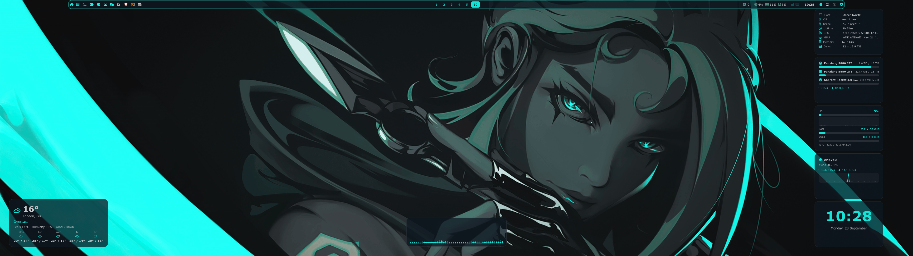 | 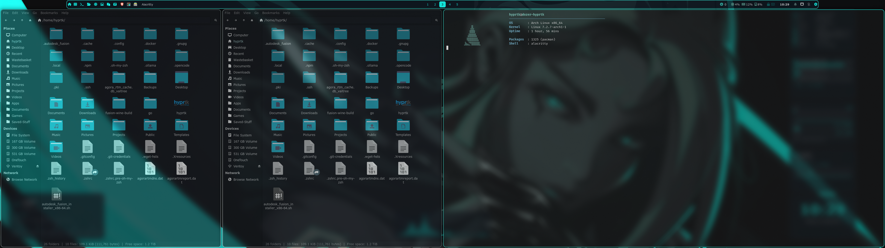 | 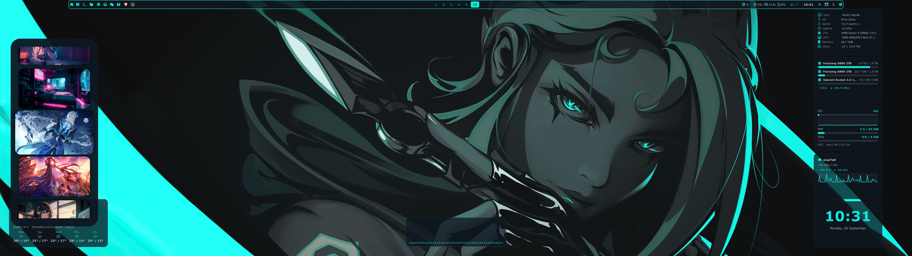 |
| 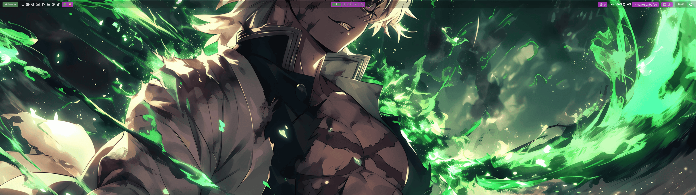 | 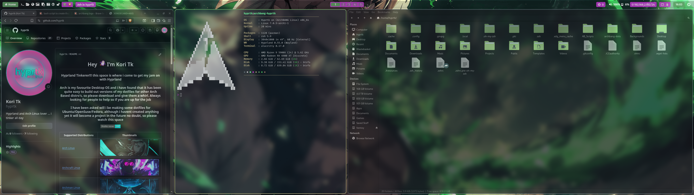 | 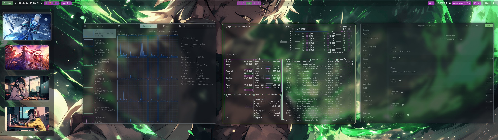 |
| 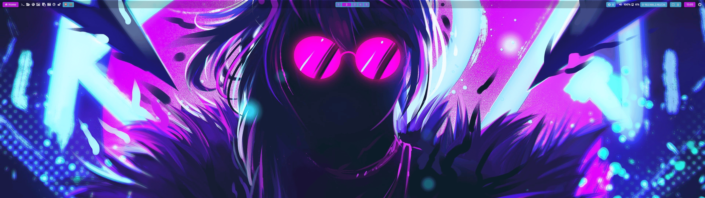 | 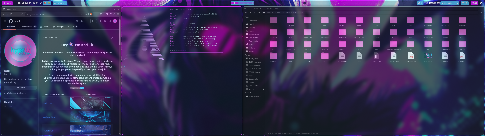 | 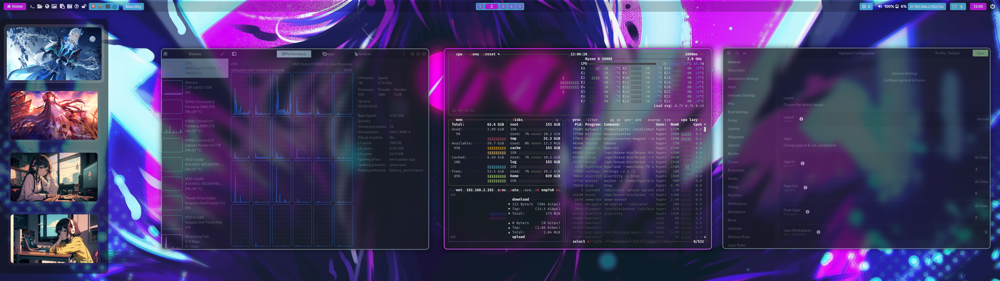 |
| 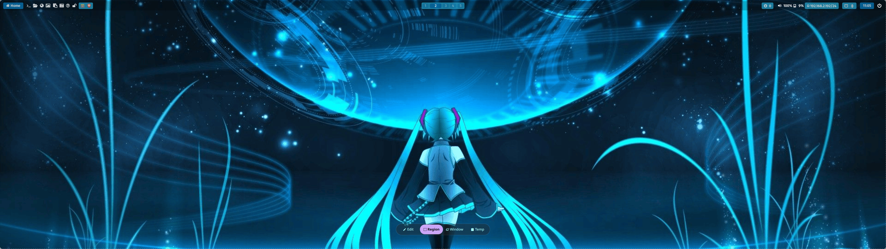 | 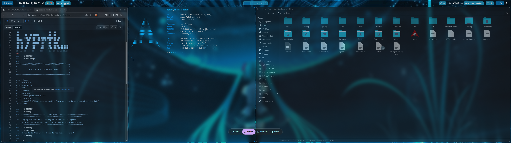 | 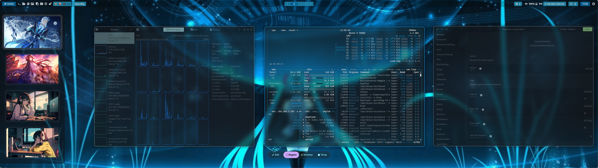 |
| 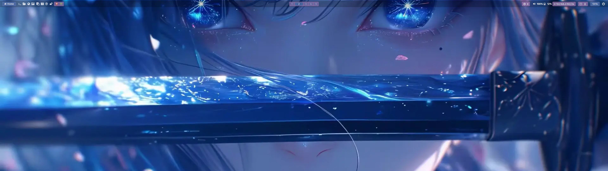 | 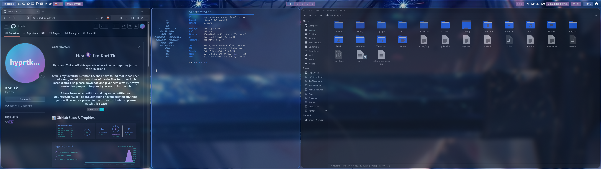 | 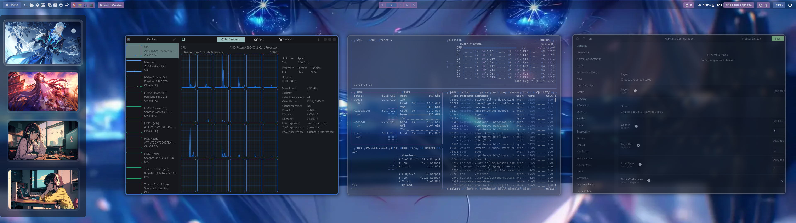 |
| 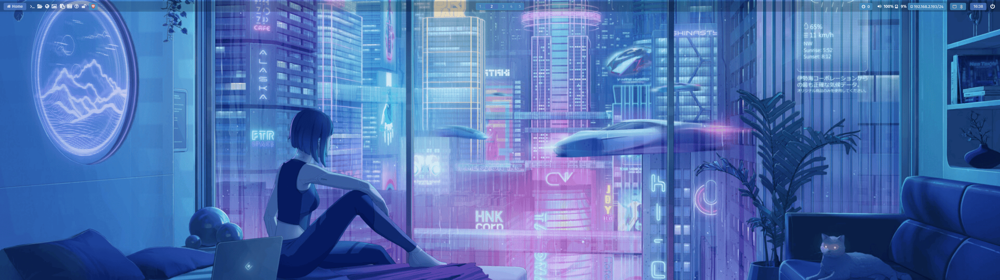 | 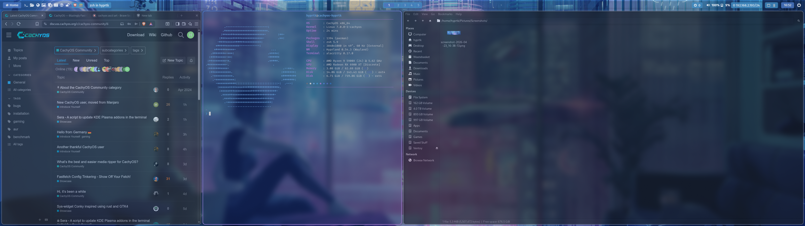 | 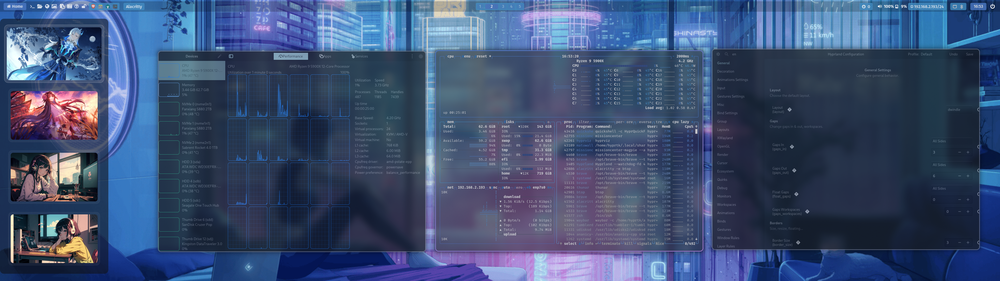 |
| 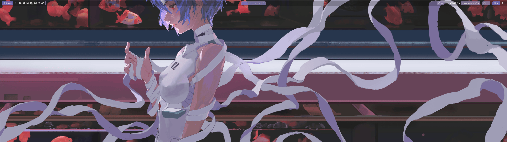 | 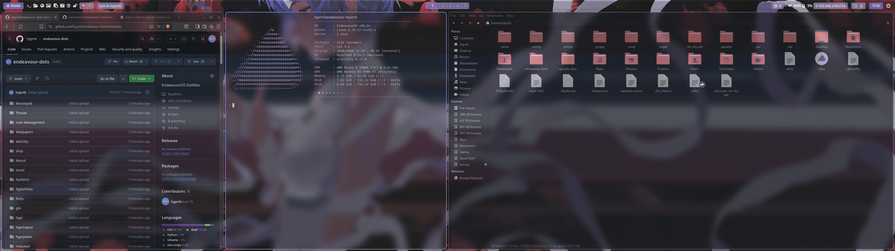 | 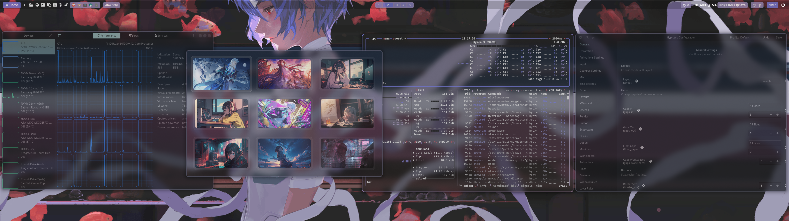 |
| 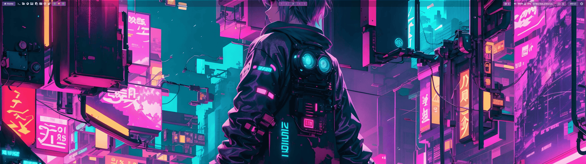 | 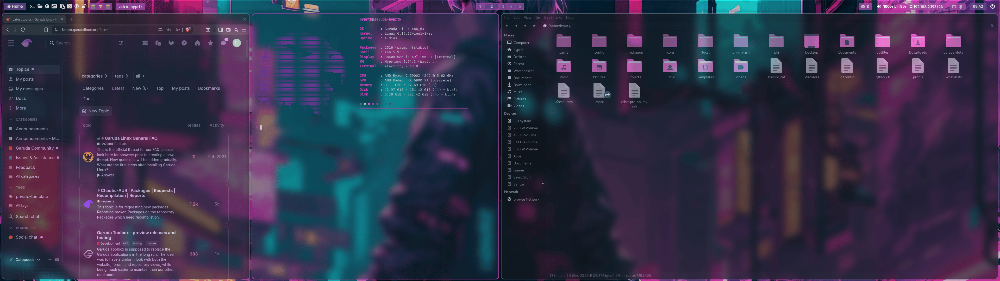 | 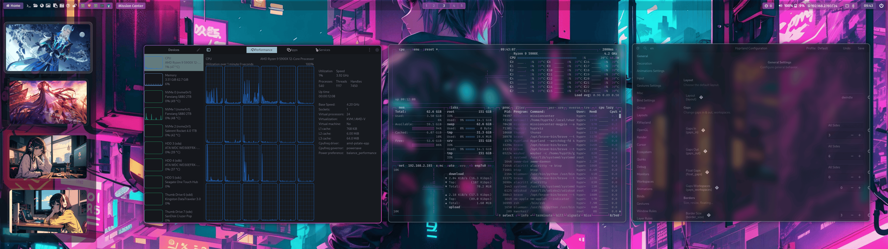 |
| 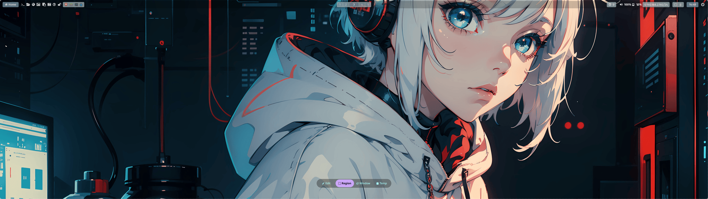 | 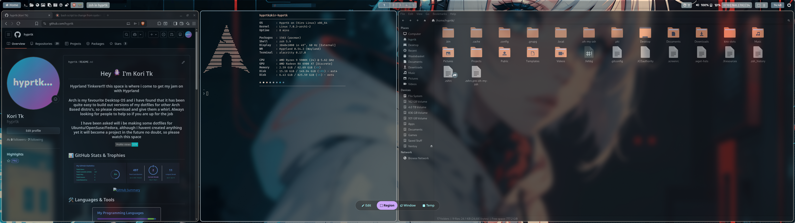 | 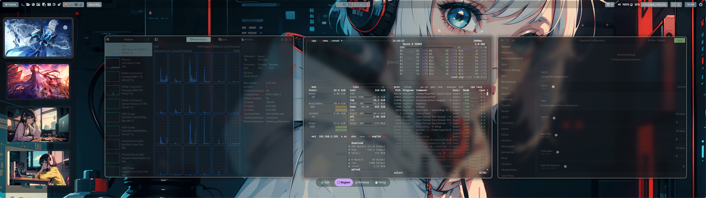 |
| 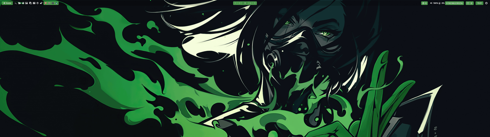 | 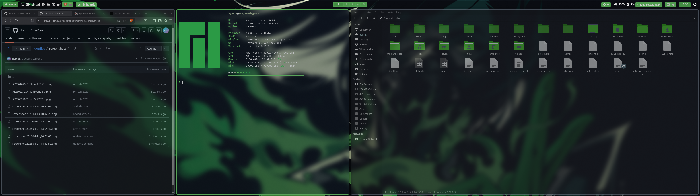 | 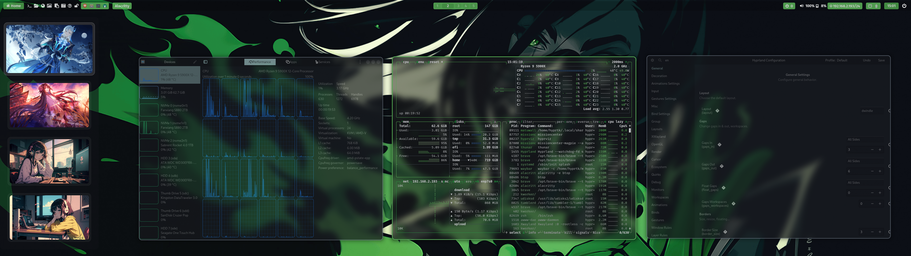 |
| 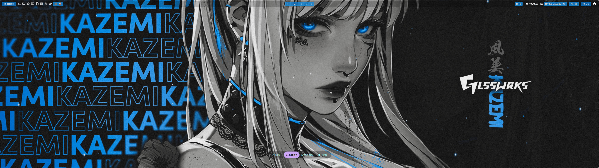 | 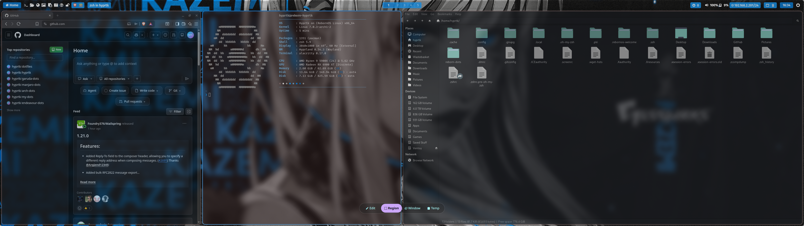 | 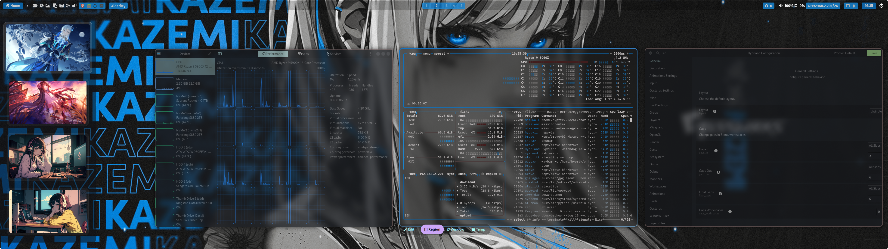 |

More screenshots per distro live in [`assets/screenshots/`](https://github.com/hyprtk/dotfiles/tree/main/assets/screenshots).

## Branding

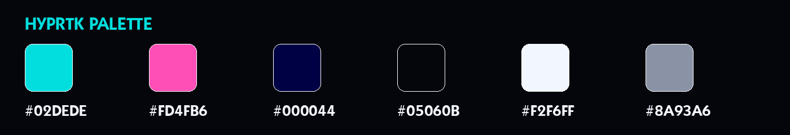

The suite is one mark, one palette and one typeface across every repository,
wiki and app icon. The mark is the **v09** direction: a near-black disc, a
gradient ring, the oversized `ht` anchor and the component glyph in a
gradient-ringed badge. The wordmark is **KoblenzSerial Bold** — `hypr` in cyan,
`tk` in magenta — converted to outlines, so nothing needs the font installed.

| token | hex | use |
| --- | --- | --- |
| cyan | `#02DEDE` | primary accent, `hypr` |
| magenta | `#FD4FB6` | secondary accent, `tk` |
| navy | `#000044` | deep field |
| ink | `#05060B` | background |
| white | `#F2F6FF` | foreground |
| muted | `#8A93A6` | tags, secondary text |

Rules: keep one cap height of clear space around the mark, never stretch it,
never re-colour the cyan/magenta split, and below 44 px use the glyph-led
`-small` icon. The icon names match the desktop entries (`hyprtk`,
`hyprtk-bar-qt`, `hyprtk-file-manager`, `hyprtk-editor`, `hyprtk-term`,
`hyprtk-calc`, `hyprtk-shot`, `hyprtk-rec`, `hyprtk-config-manager`, `hyprtk-usb`,
`hyprtk-iso-creator`).
Banners, icons and the palette strip in this README are generated from the
brand kit's `gen/docs.py`.

## License

[GPL-2.0](LICENSE)