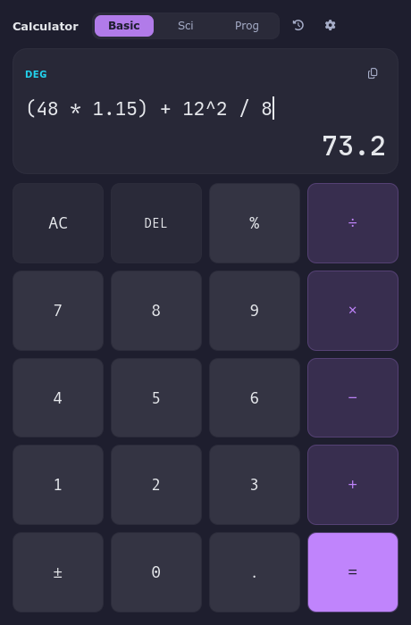
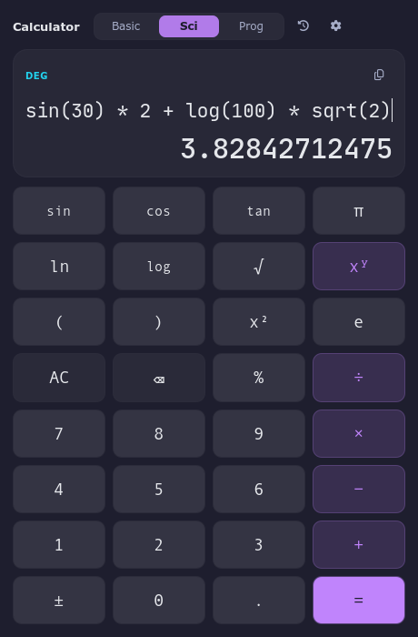
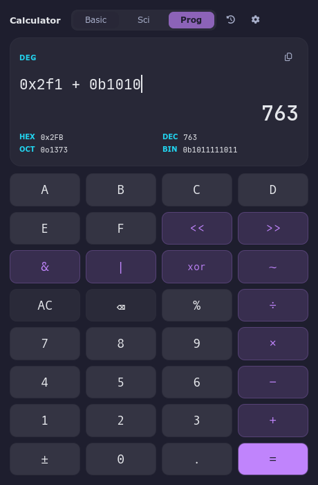

<div align="center">


[](https://github.com/hyprtk)
[](CHANGELOG.md)
[](https://github.com/hyprtk/hyprtk-calc/wiki)
[](LICENSE)

</div>

# hyprtk-calc

> **Part of the hyprtk suite** — [dotfiles](https://github.com/hyprtk/dotfiles) · [bar-qt](https://github.com/hyprtk/hyprtk-bar-qt) · [file manager](https://github.com/hyprtk/hyprtk-file-manager) · [editor](https://github.com/hyprtk/hyprtk-editor) · [terminal](https://github.com/hyprtk/hyprtk-term) · [calculator](https://github.com/hyprtk/hyprtk-calc) · [screenshot](https://github.com/hyprtk/hyprtk-shot) · [recorder](https://github.com/hyprtk/hyprtk-rec) · [system manager](https://github.com/hyprtk/hyprtk-system-manager) · [config manager](https://github.com/hyprtk/hyprtk-hyprland-config-manager) · [hyprtk-usb](https://github.com/hyprtk/hyprtk-usb) · [ISO creator](https://github.com/hyprtk/Hyprtk-ISO-Creator)

A small, exact, theme-aware calculator for the hyprtk desktop — Qt Quick/QML on
the front, Python `decimal` underneath. It opens from a keybinding in a fraction
of a second, evaluates while you type, and `0.1 + 0.2` is `0.3`.

**Current version: 0.1.2** — see [CHANGELOG.md](CHANGELOG.md) and [PLAN.md](PLAN.md).





## Why another calculator

The suite already has GNOME Calculator or Qalculate! one package install away.
Neither looks like the desktop, neither ships a Symbols Nerd Font keypad, and
neither can be extended with the suite's own QML. hyprtk-calc is ~2,000 lines,
depends on nothing beyond PySide6 (already a suite dependency) and the Python
standard library, follows the wallpaper, and is honest about its numbers:

- **Exact decimal arithmetic.** `0.1 + 0.2 = 0.3`, `1/3` to as many digits as
  you ask for, no `0.30000000000000004`. The survey and the measurements are in
  [RESEARCH.md](RESEARCH.md).
- **A real parser, not `eval`.** Hand-written tokenizer and precedence parser,
  so literals stay `Decimal`, implicit multiplication works (`2pi`, `3(4+5)`),
  and pasted text cannot execute anything.
- **One expression, two ways to enter it.** Type it, tap it, or mix: the keypad
  inserts at the cursor, so `sin(` + `30` + `)` is the same expression either
  way.

## Features

**Numbers**
- `decimal.Decimal` throughout; 12 significant digits by default, 3–60 in settings
- `+ − × ÷ ^ ! %`, parentheses, unary sign, right-associative `^`
- Implicit multiplication: `2pi`, `3(4+5)`, `(2)(3)`, `2 sin(30)`
- Bitwise: `& | xor ~ << >>`, `0x`/`0b`/`0o` literals, `1_000_000`
- 40 functions: trig and hyperbolic (angle-aware), `ln`/`log`/`log2`, roots,
  `round`/`floor`/`ceil`, `gcd`/`lcm`, `ncr`/`npr`, `min`/`max`/`sign`, `hypot`
- Constants `pi`, `e`, `tau`, `phi`, `ans`, and named variables

**Window**
- Live result while typing (`Enter` commits, `Esc` clears)
- Basic / Scientific / Programmer keypads
- Programmer readout of the result in HEX, DEC, OCT and BIN — click one to copy
- History drawer: persisted, deduplicated, click to recall, `↑`/`↓` to walk
- Settings sheet: precision, angle unit, digit grouping, keypad, live result,
  always-on-top
- Right-click free, keyboard-first, `Ctrl+C` copies the result

**Suite**
- Palette resolved from the same pywal/bar source as the bar, editor, file
  manager and terminal; a wallpaper change repaints the app
- Symbols Nerd Font chrome, v09 suite icon, `hyprtk-calc.desktop`
- A shell mode in the same binary, so `hyprtk-calc "2+2"` is a calculator too

## Install

```sh
./install.sh                # user install: ~/.local/share/hyprtk-calc
./install.sh --system       # /usr/local, all users (the live ISO does this)
./install.sh --uninstall
```

PySide6 comes from the distro. Debian/Ubuntu package it without the QML
bindings, so the installer falls back to a private venv under the payload
directory — the same pattern the editor and the suite's GUI tools use.

## Usage

```sh
hyprtk-calc                 # the window
hyprtk-calc "2 + 2 * 3"     # 8
hyprtk-calc -p 20 "1/3"     # 0.33333333333333333333
hyprtk-calc -a rad "sin(pi/2)"
hyprtk-calc -b 16 "255"     # 0xFF
hyprtk-calc --all-bases 255 # the four-base readout
echo "sqrt(2)" | hyprtk-calc -
hyprtk-calc --json "1/4"    # {"ok": true, "expression": "1/4", "result": "0.25", …}
hyprtk-calc --history
```

A bare argument is an expression, so the same binary is both the GUI and the
shell calculator; `-` reads expressions from stdin, one per line. A bare
`hyprtk-calc` always opens the window — a desktop launcher has no tty, so
guessing from stdin would make it exit instantly. Exit status is 1 on a
calculation error.

### Expression syntax

| Syntax | Meaning |
|---|---|
| `^` or `**` | power, right associative (`2^3^2` = 512) |
| `!` | factorial (`5!` = 120, `3!!` = 720) |
| `%` | percent of one: `50%` = 0.5, `200 * 15%` = 30 |
| `x xor y`, `x & y`, `x \| y`, `~x` | bitwise, integers only |
| `x << n`, `x >> n` | shifts |
| `0x1f`, `0b1010`, `0o17`, `1_000` | literals |
| `2pi`, `3(4+5)`, `2 sin(30)` | implicit multiplication |
| `sin 30`, `sqrt 9`, `√9` | one-argument call without parentheses |
| `pi`, `e`, `tau`, `phi`, `ans` | constants and the last answer |
| `deg(x)`, `rad(x)` | explicit angle conversion |

`%` is a unit, not a magic operator: `100 + 10%` is `100.1`, not `110`. That is
the Qalculate!/SpeedCrunch reading, and it keeps `+` meaning one thing.

Transcendental functions (`sin`, `ln`, `exp`, …) run in double precision and are
then rounded to your display precision; everything else is exact decimal for as
many digits as you ask for.

### Keyboard

| Key | Action |
|---|---|
| `Enter` | commit to history, fix the result |
| `Esc` | clear |
| `↑` / `↓` | previous / next history entry |
| `Ctrl+C` | copy the result (when nothing is selected) |
| `Ctrl+L` | clear |
| `Ctrl+H` | history drawer |
| `Ctrl+,` | settings |

## Architecture

```
hyprtk_calc/
  number.py      Decimal literals, formatting, grouping, base conversion
  evaluator.py   tokenizer, precedence parser, functions, Context
  history.py     append-only JSONL history
  settings.py    ~/.config/hyprtk-calc/config.json
  palette.py     pywal/bar theme -> UI tokens
  bridge.py      the QML facade
  cli.py         the shell calculator
  app.py         QGuiApplication + QML engine
  qml/           Main.qml, Keypad.qml, components/, theme/
```

Python owns numbers and storage, QML owns chrome. `Bridge` is the only object
crossing the boundary. Full design notes and measurements:
[RESEARCH.md](RESEARCH.md) · [PLAN.md](PLAN.md).

## Development

```sh
make test      # 60 unit tests
make qa        # tests + compileall + qmllint + headless boot + installer round-trip
make run       # from the source tree
make shot      # headless screenshot to docs/shot.png
```

## License

MIT — see [LICENSE](LICENSE).

---

## Branding


The mark is the suite's **v09** direction: an oversized `ht` monogram on an ink
field, a gradient ring, and the component glyph in a badge. The wordmark is
**KoblenzSerial Bold**, converted to outlines so no font install is needed.
The banner, icon and palette are generated from the brand kit described in the
[dotfiles README](https://github.com/hyprtk/dotfiles#branding).

---

## Part of the hyprtk suite

hyprtk is one desktop kept in nine repositories: every one of them installs
or configures part of the same pywal-themed, Arch-first Hyprland setup.

| project | what it is |
| --- | --- |
| [**dotfiles**](https://github.com/hyprtk/dotfiles) | the desktop itself: the any-distro installer, the Hyprland Lua config, themes and 60+ scripts |
| [**hyprtk-bar-qt**](https://github.com/hyprtk/hyprtk-bar-qt) | the Qt6/QML (Quickshell) bar and everything it owns: launcher, notifications, tray, quick settings, desktop widgets |
| [**hyprtk-fm**](https://github.com/hyprtk/hyprtk-file-manager) | the Qt6/QML file manager, default for `Super+F` and `inode/directory` |
| [**hyprtk-editor**](https://github.com/hyprtk/hyprtk-editor) | the Qt Quick text editor, default for `text/plain` and `text/markdown` |
| [**hyprtk-term**](https://github.com/hyprtk/hyprtk-term) | the Qt Quick terminal: libvterm core, tabs, scrollback search, pywal palette |
| [**hyprtk-calc**](https://github.com/hyprtk/hyprtk-calc) | the Qt Quick calculator: exact decimal arithmetic, three modes |
| [**config-manager**](https://github.com/hyprtk/hyprtk-hyprland-config-manager) | the Hyprland settings GUI, opened from the bar's Settings |
| [**hyprtk-usb**](https://github.com/hyprtk/hyprtk-usb) | writes a hyprtk ISO to a USB stick, with optional persistence |
| [**ISO creator**](https://github.com/hyprtk/Hyprtk-ISO-Creator) | builds the installable ISO: `airootfs`, package lists, first-run seed |

**This project is the calculator** in that list; the desktop as a whole lives in
the [dotfiles](https://github.com/hyprtk/dotfiles) repository.
