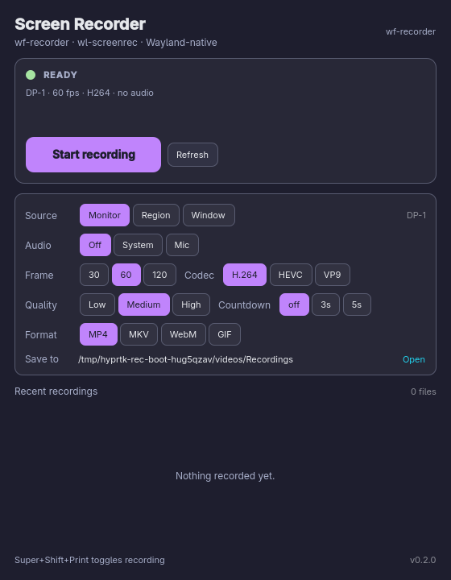
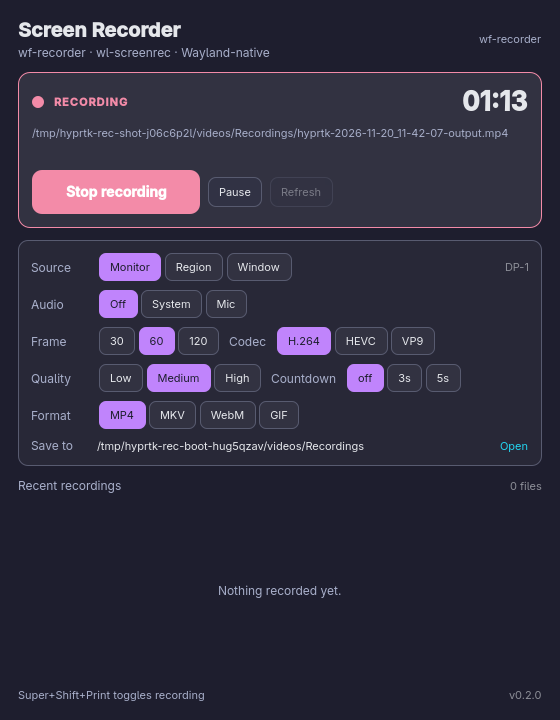

<div align="center">


[](https://github.com/hyprtk)
[](CHANGELOG.md)
[](LICENSE)

</div>

# hyprtk-rec

> **Part of the hyprtk suite** — [dotfiles](https://github.com/hyprtk/dotfiles) · [bar-qt](https://github.com/hyprtk/hyprtk-bar-qt) · [file manager](https://github.com/hyprtk/hyprtk-file-manager) · [editor](https://github.com/hyprtk/hyprtk-editor) · [terminal](https://github.com/hyprtk/hyprtk-term) · [calculator](https://github.com/hyprtk/hyprtk-calc) · [screenshot](https://github.com/hyprtk/hyprtk-shot) · [recorder](https://github.com/hyprtk/hyprtk-rec) · [system manager](https://github.com/hyprtk/hyprtk-system-manager) · [config manager](https://github.com/hyprtk/hyprtk-hyprland-config-manager) · [hyprtk-usb](https://github.com/hyprtk/hyprtk-usb) · [ISO creator](https://github.com/hyprtk/Hyprtk-ISO-Creator)

A Wayland-native screen recorder for the hyprtk desktop. Pick a monitor, a
region or a window, choose audio, press record. The app drives `wf-recorder` (or
`wl-screenrec` when it is installed) and stays out of the encoder's way.





## What it does

- **Three sources** — the focused monitor (or a named one), a region drawn with
  `slurp`, or a window: the focused one by default, or any open window chosen
  from the picker (`--window ADDRESS` on the command line).
- **Audio** — off, system audio (the default sink's monitor), the default
  microphone, or **both** (a null sink fed by two loopbacks, so the recording has
  one mixed track); any named PipeWire/PulseAudio source via `--device`.
- **Sensible defaults** — 60 fps, H.264, CRF-based quality, MP4, cursor
  included, countdown off, CPU encoding.
- **VAAPI (opt-in)** — `--vaapi` / Encoder → VAAPI for h264 and hevc. The device
  is probed before it is offered: a `renderD*` node is not the same as a working
  VAAPI stack, and the window says why when it is not.
- **A real toggle** — `hyprtk-rec --toggle` starts if idle and stops if
  recording, from a keybinding, with no window involved.
- **State that survives the process** — the running recording is described in
  `$XDG_RUNTIME_DIR/hyprtk-rec/state.json`, so `status` and `stop` work from a
  second invocation and a stale file is cleaned up after a crash.
- **Pause and resume** — `SIGSTOP`/`SIGCONT`, best effort, documented below.
- **A recording HUD** — a pinned 240x56 window with the timer and Pause/Stop,
  visible for as long as a recording runs (including one started by a
  keybinding), and it never takes focus.


- **Recent list** — every finished file with duration and size, open or delete.
- **A settings sheet** — the "Settings" link in the header opens the things the
  daily panel does not hold: the save folder (editable, `~` expanded),
  notifications on/off, the length of the recent list, the encoder backend
  (auto / wf-recorder / wl-screenrec) and a reset to defaults.
- **GIF output** — `container: gif` writes an animated GIF through
  `wf-recorder` (frame rate capped at 30, no audio track). Everything else stays
  a video container.
- **Buttons on the notification** — "Open folder" and "Copy path", handled by a
  detached helper so the buttons still work after the window has closed. A
  daemon that does not support actions gets the same notification without
  buttons rather than nothing.
- **Replay buffer (where `wl-screenrec` installs)** — `--replay 30` keeps the last
  30 seconds in memory; `Save replay` (window button, HUD, or
  `hyprtk-rec save-replay`) flushes them and keeps recording. Without
  `wl-screenrec` the setting is disabled and says why.
- **Trim without re-encoding** — `hyprtk-rec trim clip.mp4 --from 12 --to 30`
  (or `--last`) cuts with ffmpeg's stream copy; `--reencode` is the
  frame-accurate, slower option, `--replace` overwrites the original.
- **A crash does not lose the file** — the state file records the path, and the
  next start adopts a partial recording whose encoder is gone instead of
  forgetting it.

## Install

```sh
./install.sh            # ~/.local/share/hyprtk-rec + ~/.local/bin/hyprtk-rec
./install.sh --system   # /usr/local (used by the live ISO)
./install.sh --uninstall
```

Requirements: `python3` + PySide6 (Qt Quick) and one recorder — `wf-recorder`
is already a suite dependency; `wl-screenrec` is optional and faster. `slurp`
for region selection, `pactl` for audio device discovery, libnotify for
notifications.

`wl-screenrec` is built from upstream's git head, not the AUR release: the 0.3.2
tarball predates the ffmpeg-9 support commits, and the AUR `-git` lockfile pins
`ffmpeg-next`/`ffmpeg-sys-next` 9.0.x, which do not compile against ffmpeg 9.1.
`packaging/wl-screenrec-git/PKGBUILD` bumps both crates (semver-compatible with
upstream's `9.0.0` requirement) and builds from main:

```sh
cd packaging/wl-screenrec-git && makepkg -f && sudo pacman -U wl-screenrec-git-*.pkg.tar.zst
```

VAAPI needs the Mesa driver (`libva-mesa-driver`) **and** a session that is not
pinning `LIBVA_DRIVER_NAME` to another vendor — an NVIDIA env block applied on an
AMD box makes `vainfo` fail with `-1` and both recorders lose the GPU path.

## Use

| Action | How |
|---|---|
| Window | `hyprtk-rec` |
| Settings | "Settings" in the window header |
| HUD | appears by itself while recording |
| Start / stop | `hyprtk-rec --toggle` (keyboard: `Super+Shift+Print`) |
| Start with a region | `hyprtk-rec start --source region --countdown 3` |
| Start with system audio | `hyprtk-rec start --audio system` |
| Stop and get the path | `hyprtk-rec stop --json` |
| Is it recording? | `hyprtk-rec status --json` |
| What can be recorded? | `hyprtk-rec sources` |
| Start a 30 s replay buffer | `hyprtk-rec start --replay 30` |
| Save the buffered seconds | `hyprtk-rec save-replay` |
| Trim the last recording | `hyprtk-rec trim --last --from 5 --to 20` |
| Trim a file (keep it) | `hyprtk-rec trim clip.mp4 --from 0:10 --to 0:45` |

Options: `--source output|region|window`, `--output NAME`, `--region "x,y WxH"`,
`--fps 5-240`, `--codec h264|hevc|vp9|av1`, `--quality low|medium|high`,
`--audio none|system|mic|mix`, `--device NAME`, `--countdown N`, `--dir PATH`,
`--backend auto|wf-recorder|wl-screenrec`, `--container mp4|mkv|webm|gif`,
`--window ADDRESS`, `--vaapi`, `--replay N`, `--no-cursor`, `--json`.

In the window: `Ctrl+R` toggles recording, `Space` pauses, `Esc` quits.

## Configuration

`~/.config/hyprtk-rec/config.json`:

| key | meaning |
|---|---|
| `source` | `output`, `region` or `window` |
| `window` | Hyprland client address from the picker (empty = focused) |
| `fps` | 5–240 |
| `codec`, `quality` | `h264`/`hevc`/`vp9`/`av1`, `low`/`medium`/`high` |
| `audio` | `none`, `system`, `mic`, `mix` |
| `countdown` | seconds before recording (0–30) |
| `dir` | output directory (empty = `~/Videos/Recordings`) |
| `backend` | `auto`, `wf-recorder`, `wl-screenrec` |
| `container` | `mp4`, `mkv`, `webm`, `gif` |
| `cursor` | include the pointer |
| `replay` | seconds of replay history, `wl-screenrec` only (0 = off) |
| `vaapi` | GPU encoding (probed; off by default) |
| `notify` | start/stop notifications |

Files are named `hyprtk-YYYY-MM-DD_HH-MM-SS-<source>.mp4` and logged to
`~/.config/hyprtk-rec/history.jsonl`.

## How it works

```
hyprtk_rec/
  sources.py   hyprctl monitors/clients, slurp, geometry (no Qt)
  audio.py     pactl: default sink monitor, default source, source list
  recorder.py  argv builders, state file, start/stop/pause, backend/container choice
  notify.py    "Open folder" / "Copy path" on the saved notification
  trim.py      time parsing + ffmpeg stream-copy trimming
  store.py     naming, history, duration and size formatting
  settings.py  validated config file
  palette.py   pywal/bar theme → tokens
  bridge.py    QML facade: countdown, elapsed tick, notifications, recents
  cli.py       start/stop/toggle/status/pause/resume/sources
  app.py       QGuiApplication + QQmlApplicationEngine
  qml/         Main.qml (state card, options, recents), components/
```

Three things worth knowing:

1. **The state file is the API.** A keybinding starts a recording in one
   process and stops it in another; the pid, path, start time and pause
   accounting live on disk, not in memory. `pid_alive()` decides whether the file
   is truth or a leftover.
2. **SIGINT stops, SIGSTOP pauses.** Both encoders finalize their container on
   SIGINT, which is why "stop" waits for the process instead of killing it.
   Pause is the kernel's signal, so the file keeps its timeline but the frozen
   frames are written on resume — good enough for a demo, not frame-accurate.
3. **The backend is a policy, not a hard dependency.** `auto` prefers
   `wl-screenrec` (GPU-encoded, ~2% CPU in its own benchmarks) and falls back to
   `wf-recorder`; an explicit choice that is missing is an error, never a silent
   switch.

## Test

```sh
make test    # argv, state file, audio parsing, sources, stores, settings, CLI, docs
make qa      # + compileall, qmllint, headless boot, installer round-trip
make shot    # regenerate docs/*.png offscreen
```

The headless boot check loads the real QML, swaps in a fake encoder, records,
pauses, resumes, stops, and fails on any QML warning.

## Suite integration

`hyprtk-rec` replaces the `wf-record-start.sh`/`wf-record-stop.sh` pair as the
suite's recorder: `Super+Shift+Print` becomes one toggle, the bar gets a quick
link, and the ISO installs it system-wide. See [PLAN.md](PLAN.md) for the exact
edits.

MIT licensed.
