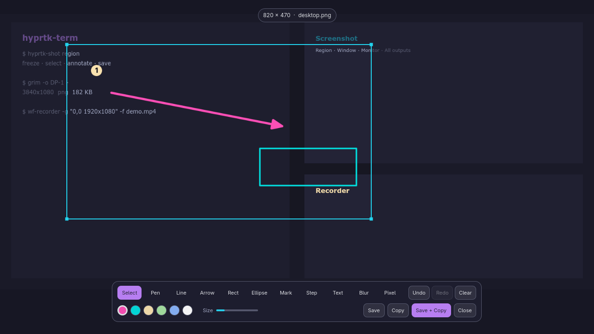
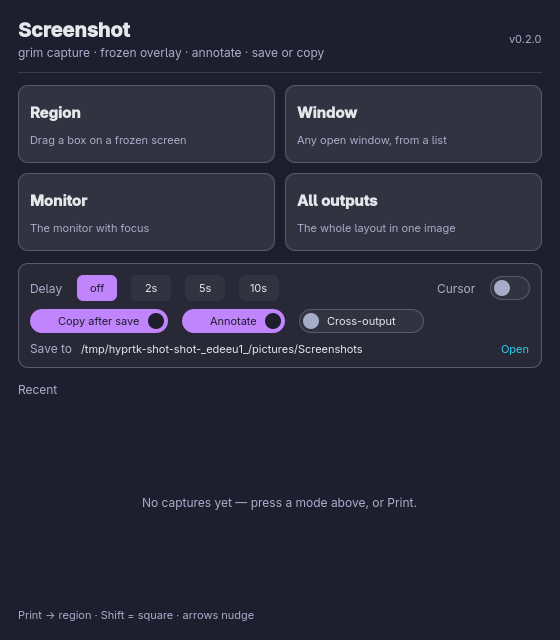

<div align="center">


[](https://github.com/hyprtk)
[](CHANGELOG.md)
[](LICENSE)

</div>

# hyprtk-shot

> **Part of the hyprtk suite** — [dotfiles](https://github.com/hyprtk/dotfiles) · [bar-qt](https://github.com/hyprtk/hyprtk-bar-qt) · [file manager](https://github.com/hyprtk/hyprtk-file-manager) · [editor](https://github.com/hyprtk/hyprtk-editor) · [terminal](https://github.com/hyprtk/hyprtk-term) · [calculator](https://github.com/hyprtk/hyprtk-calc) · [screenshot](https://github.com/hyprtk/hyprtk-shot) · [recorder](https://github.com/hyprtk/hyprtk-rec) · [system manager](https://github.com/hyprtk/hyprtk-system-manager) · [config manager](https://github.com/hyprtk/hyprtk-hyprland-config-manager) · [hyprtk-usb](https://github.com/hyprtk/hyprtk-usb) · [ISO creator](https://github.com/hyprtk/Hyprtk-ISO-Creator)

A Wayland-native screenshot tool for the hyprtk desktop. One keypress freezes
the screen, you drag a box, annotate it, then save, copy, or both.



Built for Hyprland the way Flameshot is built for X11 and Spectacle for Plasma:
the capture comes from `grim` (the compositor's own screencopy protocol), the
selection and annotation happen in a fullscreen overlay that draws the frozen
frame, so the overlay can never photograph itself and nothing needs a portal
prompt.

## What it does

- **Four capture modes** — region, any window on the current workspace (a
  picker, focused first), focused monitor, all outputs. Window capture is a
  geometry crop, so a window that is not on screen cannot be captured.
  Region freezes the focused monitor; the box you draw is the crop. A
  cross-output region comes from `slurp` instead (one toggle in the launcher,
  `--slurp` on the command line).
- **Frozen overlay** — the screen stops while you select, like a still frame.
- **Annotation** — pen, line, arrow, rectangle, ellipse, highlighter, numbered
  step markers, text, blur and pixelate.
- **Selection you can place exactly** — hold `Shift` while dragging for a
  square, nudge the box with the arrow keys (1 px, `Shift` = 10 px), drag any of
  the eight grips to resize after annotating, and undo a selection change the
  same way you undo a stroke.
- **Pin to screen** — keep the finished crop on screen as a floating,
  always-on-top window (`Pin` in the overlay, or `--pin` when opening a file);
  double-click or the close button dismisses it.
- **Save / copy / both** — `wl-copy` for the clipboard, PNG/JPEG/WebP on disk,
  named `hyprtk-YYYY-MM-DD_HH-MM-SS-<mode>.png` under `~/Pictures/Screenshots`.
- **Scriptable** — `hyprtk-shot region --copy`, `--stdout` for pipes, `--json`
  for status, `--list-outputs` to see what grim will target.
- **Theme-aware** — the same pywal/bar palette as the rest of the suite, so a
  wallpaper change repaints the overlay and the launcher.



## Install

```sh
./install.sh            # ~/.local/share/hyprtk-shot + ~/.local/bin/hyprtk-shot
./install.sh --system   # /usr/local (used by the live ISO)
./install.sh --uninstall
```

Requirements: `python3` + PySide6 (Qt Quick), `grim`, `wl-clipboard`
(`wl-copy`), and libnotify for the "saved" notification. `slurp` is optional:
the overlay is the default region picker, and slurp is only used for
cross-output selection.

Debian/Ubuntu ship PySide6 without the QML bindings; the installer detects that
and builds a private venv, the same fallback the editor and terminal use.

## Use

| Action | How |
|---|---|
| Launcher | `hyprtk-shot` |
| Region → annotate | `hyprtk-shot region` (keyboard: `Print`) |
| Focused window | `hyprtk-shot window` |
| A specific window | `hyprtk-shot window --window 0x55b1…` |
| Focused monitor | `hyprtk-shot output` |
| All outputs | `hyprtk-shot full` |
| Reopen the last capture | `hyprtk-shot last` |
| Open any image in the editor | `hyprtk-shot open shot.png` |
| Region across every output | `hyprtk-shot region --slurp` |
| Pin a capture on screen | `hyprtk-shot open shot.png --pin` |
| Straight to clipboard | `hyprtk-shot region --copy --no-edit` |
| Straight to a file | `hyprtk-shot full --save ~/Pictures/shot.png --no-edit` |
| Pipe it | `hyprtk-shot output --stdout > shot.png` |
| Status / scripting | `hyprtk-shot window --no-edit --json` |

In the overlay the first step is the region: the screen freezes with only the
crosshair and a "Drag to select a region" hint. Drag the box (hold `Shift` for a
square; move it by dragging inside; nudge it with the arrow keys, `Shift` =
10 px), and once it exists the annotation toolbar appears with `Select` active.
Then annotate, and `Enter` saves and copies (`Ctrl+S` saves, `Ctrl+C` copies,
`Pin` leaves it on screen); right-click or `Ctrl+A` chooses the whole screen,
`Ctrl+Z`/`Ctrl+Shift+Z` undo/redo (selection changes and `Clear` too), `Esc`
cancels. Until a region is chosen, `Enter` does nothing — it cannot capture the
whole screen by accident.
Tool shortcuts are `V` select, `P` pen, `L` line, `A` arrow, `R` rectangle,
`E` ellipse, `H` highlighter, `M` step marker, `T` text, `B` blur, `X` pixelate.

## Configuration

`~/.config/hyprtk-shot/config.json`, written by the launcher and by every
setting the overlay changes:

| key | meaning |
|---|---|
| `mode` | default capture mode |
| `picker` | region selection: `overlay` (default) or `slurp` (cross-output) |
| `delay` | seconds before the freeze (0–30); a countdown window is shown |
| `copy`, `save` | act after capture |
| `dir` | save directory (empty = `~/Pictures/Screenshots`) |
| `format`, `quality` | `png`/`jpg`/`webp`, 40–100 |
| `cursor` | include the pointer |
| `annotate` | open the overlay (`false` = straight to disk) |
| `dim` | how far the outside of the selection is darkened |
| `tool`, `color`, `stroke` | last annotation brush |
| `notify` | desktop notification after save |

Captures are also logged to `~/.config/hyprtk-shot/history.jsonl` so the
launcher can list recent files.

## How it works

```
hyprtk_shot/
  capture.py   grim argv + hyprctl monitors/clients parsing (no Qt)
  annotate.py  Shape model + QPainter renderer (preview and final share it)
  selection.py selection maths: square, clamp, nudge, resize
  canvas.py    QQuickPaintedItem: fit, select, drag, draw, veil
  store.py     naming, save, clipboard, history
  settings.py  validated config file
  palette.py   pywal/bar theme → tokens
  bridge.py    QML facade: session, snapshot undo/redo, save/copy, recents
  cli.py       modes and flags, no-editor path
  app.py       QGuiApplication + QQmlApplicationEngine (overlay, launcher, pin)
  qml/         Main.qml (launcher, overlay window, toolbar)
```

The three pieces that carry the weight:

1. **Capture first, then draw.** `grim` returns PNG bytes; the app decodes them
   into a `QImage` and shows that image in a fullscreen window. No live
   compositing, no recursion, no compositor-specific screencopy widget.
2. **Image coordinates, not screen coordinates.** Every mouse point is mapped
   through the fit transform into image pixels; the selection *is* the crop.
   Annotations are clamped into it, so what you see is what gets written.
3. **One renderer.** `annotate.render()` writes the file and `canvas.paint()`
   previews with the same `paint_shape()`, so a stroke cannot look one way and
   save another.

## Test

```sh
make test    # geometry, renderer, store, settings, CLI, docs
make qa      # + compileall, qmllint, headless boot, installer round-trip
make shot    # regenerate docs/*.png offscreen
```

The headless boot check opens a real QML tree, loads an image, adds shapes,
crops, saves and verifies the file, then fails on any QML warning.

## Suite integration

`hyprtk-shot` replaces the vendored HyprQuickFrame overlay as the suite's
screenshot path: `Print` and `Super+P` call it, the bar gets a quick link, and
the ISO installs it system-wide. See [PLAN.md](PLAN.md) for the exact edits.

MIT licensed.
