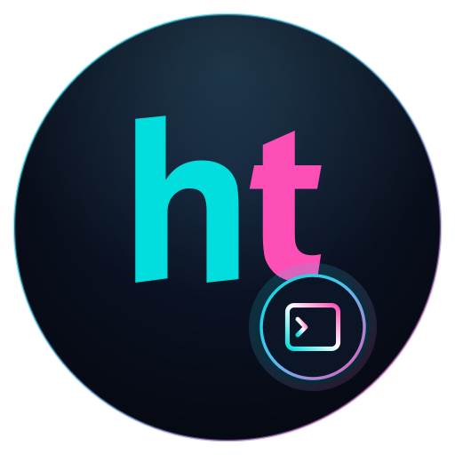
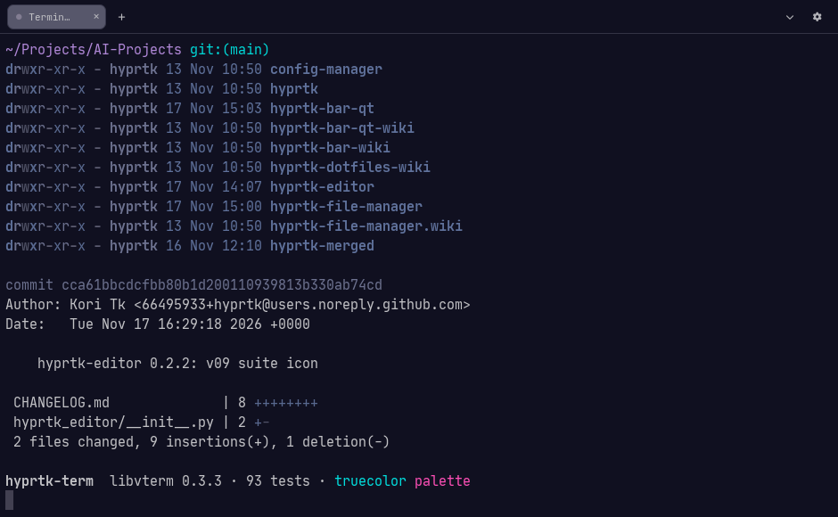

# hyprtk-term

> **Part of the hyprtk suite** — [dotfiles](https://github.com/hyprtk/dotfiles) · [bar-qt](https://github.com/hyprtk/hyprtk-bar-qt) · [file manager](https://github.com/hyprtk/hyprtk-file-manager) · [editor](https://github.com/hyprtk/hyprtk-editor) · [terminal](https://github.com/hyprtk/hyprtk-term) · [config manager](https://github.com/hyprtk/hyprtk-hyprland-config-manager) · [hyprtk-usb](https://github.com/hyprtk/hyprtk-usb) · [ISO creator](https://github.com/hyprtk/Hyprtk-ISO-Creator)

A fast, theme-aware terminal emulator for the hyprtk desktop — Qt Quick/QML on
the front, Python in the middle and **libvterm** (Neovim's emulator core)
underneath. It follows the wallpaper, opens in a few hundred milliseconds and
keeps a real shell honest: alt screen, truecolor, wide characters, scrollback,
mouse reporting and bracketed paste all work.

**Current version: 0.2.3** — see [CHANGELOG.md](CHANGELOG.md) and [PLAN.md](PLAN.md).






## Why another terminal

The suite already ships Alacritty and Kitty. Neither knows about the bar's
theme, neither can be extended with the suite's own QML, and both are another
distro package to carry. hyprtk-term is ~2,000 lines, depends on libvterm (in
every supported archive) and paints a grid on the CPU — which the benchmarks in
[RESEARCH.md](RESEARCH.md) show is not the disadvantage it sounds like.

## Features

**Emulation**
- libvterm core: ECMA-48 / xterm, DEC private modes, alt screen, scroll regions, reflow on resize
- 16-colour palette from pywal, 256-colour cube, 24-bit truecolor
- Bold, italic, underline (single/double/curly), strike, reverse, conceal, blink
- Wide (CJK) and combining characters, emoji fallback through the system font
- OSC 52 clipboard (both directions), OSC 0/2 window title, bracketed paste
- Mouse reporting (click, drag, any-motion) for TUI apps, with Shift to override

**Window**
- Tabs with the running program's title, middle-click to close, bell indicator
- Scrollback (10,000 lines by default) with wheel scroll and jump-to-bottom
- **Scrollback search** (`Ctrl+Shift+F`): plain or regex, case toggle, match
  count, next/previous, active match highlighted
- Linear selection, double-click word select, select-all, copy/paste
- Right-click menu, font zoom, settings sheet (`Ctrl+,`)

**Suite**
- Palette resolved from the same pywal/bar source as the editor, the file
  manager and the bar; a wallpaper change reloads every open tab
- Symbols Nerd Font chrome, v09 suite icon, `hyprtk-term.desktop`

## Install

**Arch**

```bash
sudo pacman -S libvterm python-pyside6
./install.sh
```

**Debian / Ubuntu** — `sudo apt install libvterm0 python3-pyside6.qml`
(Debian 12 and Ubuntu 24.04 package PySide6 without the QML modules; the
installer falls back to a private venv for those).

**Fedora** `sudo dnf install libvterm python3-pyside6`, **openSUSE**
`sudo zypper in libvterm0 python3-pyside6`, **Void** `sudo xbps-install libvterm
python3-PySide6`, **Alpine** `apk add libvterm py3-pyside6`.

The installer copies a tree to `~/.local/share/hyprtk-term`, links
`~/.local/bin/hyprtk-term`, writes the desktop entry with absolute paths and
registers the icon. `--system` installs under `/usr/local` for the live ISO,
`--uninstall` removes it again.

## Usage

```bash
hyprtk-term                     # login shell in ~
hyprtk-term -e btop             # run a command instead
hyprtk-term -d ~/Projects       # start somewhere else
```

| Keys | Action |
|---|---|
| `Ctrl+Shift+T` | New tab |
| `Ctrl+Shift+W` | Close tab |
| `Ctrl+Shift+N` / `Ctrl+Shift+P`, `Alt+←` / `Alt+→` | Next / previous tab |
| `Ctrl+Shift+C` / `Ctrl+Shift+V` | Copy / paste |
| `Ctrl+=` / `Ctrl+-` | Zoom |
| `Ctrl+Shift+F` | Search scrollback |
| `Ctrl+Shift+G` / `Shift+F3` | Next match |
| `Ctrl+,` | Settings |
| `Ctrl+Shift+Q` | Quit |
| `Shift`+drag | Select even when the app wants the mouse |

## Configuration

`~/.config/hyprtk-term/config.json`, written by the settings sheet:

| Key | Default | Meaning |
|---|---|---|
| `font_family` | `JetBrainsMono Nerd Font Mono` | Any installed monospace family |
| `font_size` | `11.0` | Points |
| `line_height` | `1.18` | Cell height multiplier |
| `opacity` | `0.98` | Background alpha; `< 1` makes the window translucent |
| `padding` | `6` | Pixels around the grid |
| `scrollback` | `10000` | Lines kept in history (0 disables) |
| `shell` | `""` | Blank uses `$SHELL` |
| `login_shell` | `true` | Pass `-l` to shells that support it |
| `cursor_blink` | `true` | |
| `copy_on_select` | `false` | Copy as soon as the mouse is released |

## How it works

```
PTY (pty.fork)  ->  libvterm (ctypes)  ->  row runs  ->  QPainter  ->  QML
```

- `hyprtk_term/vtcapi.py` — every libvterm signature and struct in one dict, so
  no call can be added with a missing `restype` (that bug segfaults).
- `hyprtk_term/vt.py` — the emulator: feed, damage-tracked row cache,
  scrollback ring of raw cells, key/mouse encoders, OSC 52 hooks.
- `hyprtk_term/ptyproc.py` — fork/exec, winsize, non-blocking reads.
- `hyprtk_term/terminal.py` — one QT object per tab, PTY watched by a
  `QSocketNotifier` on the GUI thread.
- `hyprtk_term/view.py` — the painted grid, selection, mouse, keys.
- `hyprtk_term/qml/` — tabs, settings, theme.

Measured on this machine: 12 MB/s parse throughput, ~2 ms to re-read an 80x24
grid, ~3 ms to paint it. Numbers and method in [RESEARCH.md](RESEARCH.md).

## Development

```bash
make test     # 122 unit tests, no display needed
make qa       # tests + qmllint + headless boot + installer round-trip
make shot     # offscreen screenshot to docs/probe.png
make run
```

## License

MIT. Part of the hyprtk suite.
