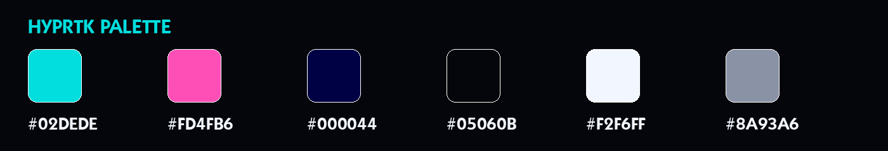

<div align="center">


[](https://github.com/hyprtk)
[](CHANGELOG.md)
[](python/pyproject.toml)

</div>

# hyprtk-usb

Write a [hyprtk](https://github.com/hyprtk/Hyprtk-ISO-Creator) ISO to a USB
stick and, optionally, add the **`hyprtk-persist`** partition the ISO's
*Hyprtk live with persistence* boot entry looks for.

A Python app using [`rich`](https://github.com/Textualize/rich), carrying the
hyprtk look: **double-border panels** in the suite palette resolved from pywal,
as **inline prompts** — no full-screen
takeover. There is also a **Qt (PySide6) GUI** (`hyprtk-usb-gui`) over the same backend.

## Install

```bash
# single-file (needs Python 3.10+); from a GitHub release
python hyprtk-usb.pyz

# or from a wheel
pip install hyprtk_usb-*.whl

# or from source
cd python && pip install -e .

# or run in place
cd python && PYTHONPATH=. python -m hyprtk_usb
```

## Usage

```bash
# interactive (TUI)
hyprtk-usb

# non-interactive (scriptable)
sudo hyprtk-usb --iso ~/Documents/Isos/hyprtk-*.iso --target /dev/sda
```

Run with no flags for the interactive flow; pass any flag for a non-interactive
run. Writing needs root — the program re-execs itself under `sudo`.

### Flags

| Flag | Meaning |
| --- | --- |
| `--iso <file>` | ISO to write (default: newest `hyprtk-*.iso` in `~/Documents/Isos` or `~`) |
| `--target <dev>` | whole disk (e.g. `/dev/sda`); partitions are refused |
| `--size <spec>` | persistence size: `8G`, `512M`, `50%`, or `rest` (default) |
| `--no-persist` | write the ISO only |
| `--refresh` | re-write the ISO, keeping an existing `hyprtk-persist` partition |
| `--dry-run` | print the plan; change nothing |
| `-y`, `--yes` | do not ask for confirmation |
| `--tui` | force the interactive TUI |
| `--version` | print the version |

## GUI

For a desktop session there is a Qt (PySide6) front end over the same backend:

```bash
hyprtk-usb-gui
```

- **Qt 6 / PySide6** — themed from the running hyprtk-bar-qt pywal palette, so it
  matches the desktop.
- The GUI runs **unprivileged**; only the write is elevated, by running
  `hyprtk_usb.helper` through **`pkexec`** (a polkit prompt). The Qt app never runs
  as root, and pkexec's stripped environment can't break the display.
- `make install` also installs a `.desktop` entry and icon, so it appears in the app menu.

Requires Qt 6 / PySide6 (`pyside6`). The single-file zipapp does **not**
carry the GUI — install the package (wheel / `pip install`) to get it.

## How it works

1. Stream the ISO (iso-hybrid, MBR) onto the whole disk.
2. Append a **1 MiB-aligned** Linux partition in the free space with
   `sfdisk --append`, preserving the ISO's own two MBR entries (the iso9660 and
   the EFI FAT).
3. `mkfs.ext4 -L hyprtk-persist` on the new partition.

The ISO's *Hyprtk live with persistence* boot entry passes
`cow_label=hyprtk-persist`, so an archiso overlay `upperdir`/`workdir` is created
on that filesystem. Booting the default entry stays ephemeral.

With `--refresh`, an existing `hyprtk-persist` partition's exact geometry is read
before the write and re-created unchanged afterwards, so the filesystem is never
resized (and the ISO must not overlap it).

## Safety

The writer refuses: a partition instead of a whole disk, a disk with mounted
partitions, the disk backing `/`, a target smaller than the ISO, an out-of-range
size, and (non-fatally, as a warning) an ISO that does not look like hyprtk.
Non-interactive runs require confirmation unless `-y`.

## Build

```bash
make test       # unittest suite (+ an sfdisk integration test)
make wheel      # sdist + wheel into python/dist (needs `pip install build`)
make zipapp     # single-file dist/hyprtk-usb.pyz (rich vendored in)
make install    # pip install --user .
```

Runtime dependencies: `rich`, and `sfdisk`/`mkfs.ext4`/`blkid`/`lsblk`/`findmnt`.

## Layout

```
python/hyprtk_usb/core.py     ISO + device discovery, planning, guardrails, writer
python/hyprtk_usb/ui.py       rich theme + hyprtk-styled panels and prompts
python/hyprtk_usb/cli.py      flags + TUI / non-interactive flows
python/hyprtk_usb/gui.py      Qt app (unprivileged) over the same backend
python/hyprtk_usb/helper.py   privileged write step, run via pkexec
python/data/                  .desktop entry + icon
python/tests/                 unittest suite
.github/workflows/            release workflow (wheel + sdist + zipapp)
```

## Branding



The mark is the suite's **v09** direction: an oversized `ht` monogram on an ink
field, a gradient ring, and the component glyph in a badge. The wordmark is
**KoblenzSerial Bold**, converted to outlines so no font install is needed.

Part of the **hyprtk suite** — [dotfiles](https://github.com/hyprtk/dotfiles) · [hyprtk-bar-qt](https://github.com/hyprtk/hyprtk-bar-qt) · [hyprtk-fm](https://github.com/hyprtk/hyprtk-file-manager) · [hyprtk-editor](https://github.com/hyprtk/hyprtk-editor) · [hyprtk-term](https://github.com/hyprtk/hyprtk-term) · [hyprtk-calc](https://github.com/hyprtk/hyprtk-calc) · [config-manager](https://github.com/hyprtk/hyprtk-hyprland-config-manager) · [hyprtk-usb](https://github.com/hyprtk/hyprtk-usb) · [ISO creator](https://github.com/hyprtk/Hyprtk-ISO-Creator)
